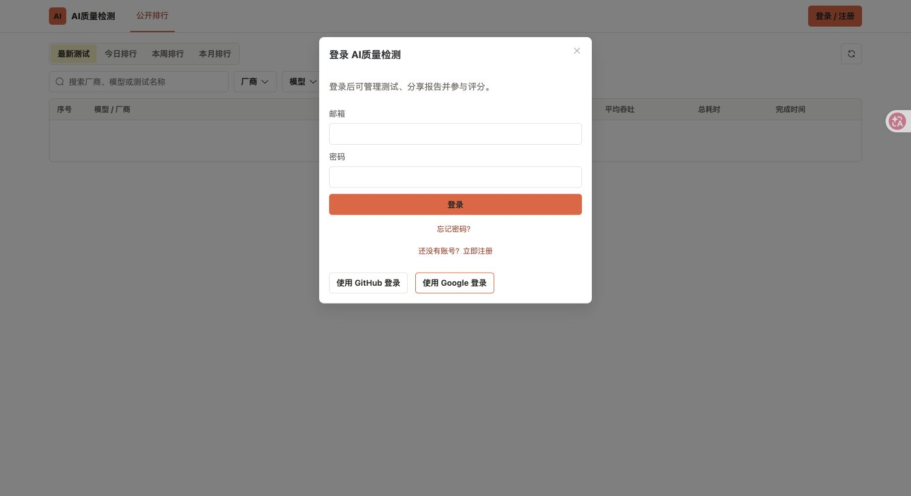
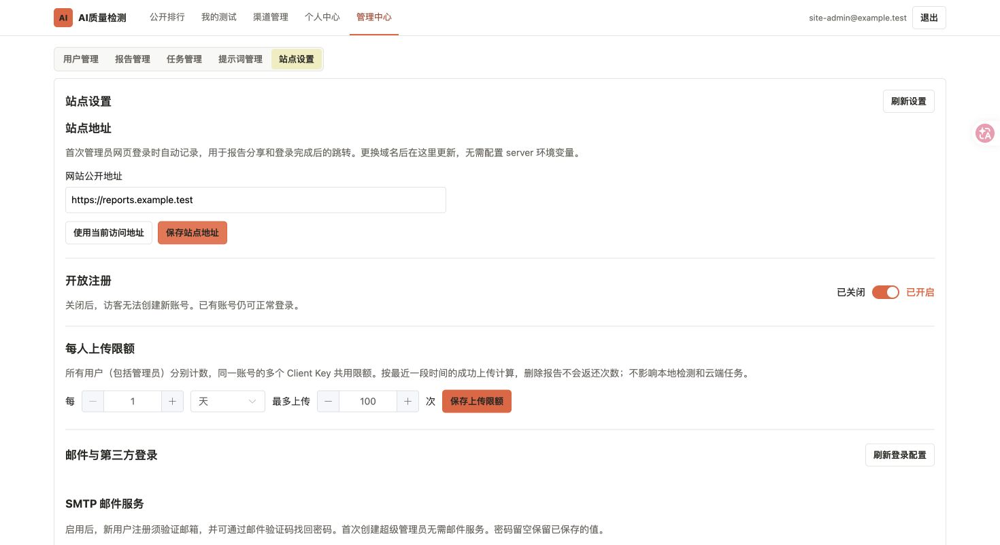
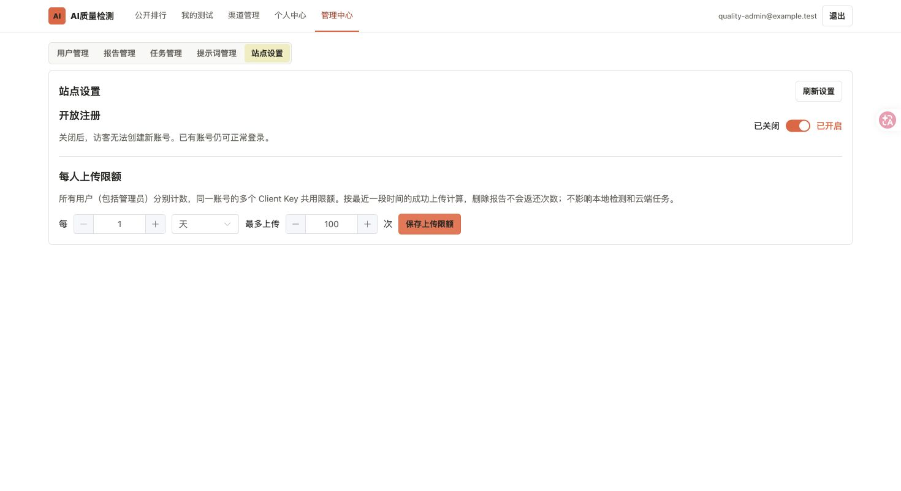
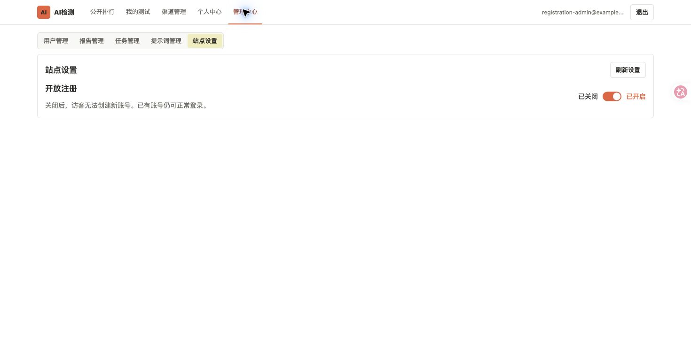
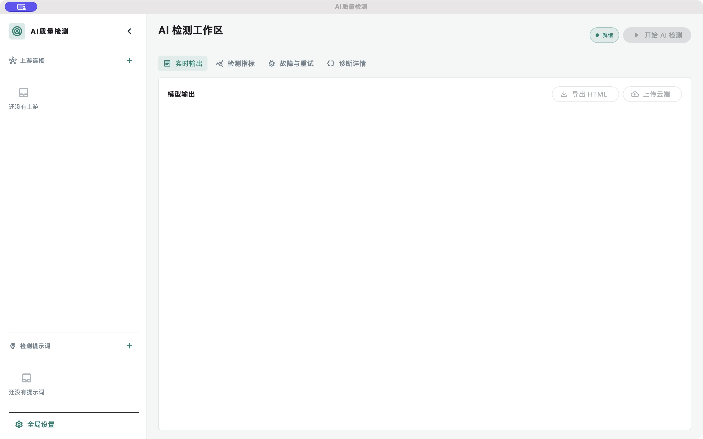
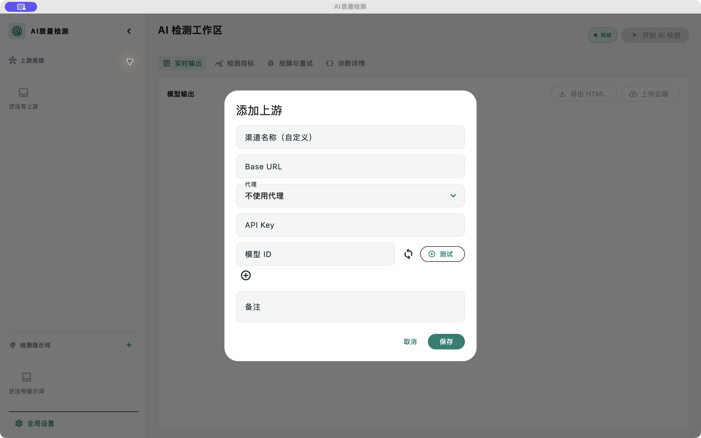

# AI质量检测

AI质量检测包含桌面客户端和云端服务两部分。

客户端使用 Flutter 开发，可以独立运行。测试、渠道配置、提示词、诊断数据和历史报告保存在本地 DuckDB 中，没有网络或没有云端时也可以完成测试，并可导出本地 HTML 报告。

云端是一个可以独立运行的评测分享站，使用 Vue 和 Axum，PostgreSQL 保存账号、任务和报告，Redis 提供缓存。云端可以单独部署并通过浏览器使用，也可以和客户端配合使用：客户端保留本地数据，通过 Client Key 将结构化测试报告上传到云端，云端再提供报告详情、评分、排行和分享链接。

客户端和云端都支持 OpenAI 兼容渠道。客户端适合本地测试和离线保存，云端适合多人访问、报告分享和集中管理。

当前版本为 **v0.1.1**。项目地址：[ai_detect](https://github.com/liuxuzzz/ai_detect)，安装包可在 [GitHub Releases](https://github.com/liuxuzzz/ai_detect/releases) 下载。

云端 Demo：[https://ai_detect.wv.gs/](https://ai_detect.wv.gs/)。可以直接在浏览器中注册和使用，也可以将这个地址填写到客户端，用于上传和分享测试报告。

## 界面预览

以下截图展示云端的登录、上传限制、站点地址和注册设置。截图中的账号、域名和数据均为示例内容。

| 云端登录 | 站点设置 |
| --- | --- |
|  |  |

| 上传限制 | 注册设置 |
| --- | --- |
|  |  |

桌面客户端包含检测工作区和渠道管理，支持本地测试、实时输出、指标曲线、故障诊断和报告上传。

| 检测工作区 | 添加渠道 |
| --- | --- |
|  |  |

## 快速使用

### 使用桌面客户端

安装对应平台的安装包，启动后在渠道管理中添加上游地址、API Key 和模型，然后选择提示词并开始测试。

客户端默认把数据保存在本机。云端地址和 Client Key 都是可选的：不填写时，客户端只使用本地 DuckDB，完全离线运行；需要上传和分享报告时，再打开「全局设置」，将云端地址填写为浏览器实际打开的站点地址，例如：

```text
https://ai_detect.wv.gs/
```

然后在云端「个人中心」创建 Client Key，复制到客户端即可。客户端填写的是完整站点地址，不需要单独填写 API 地址。只填写地址或只填写 Client Key 都不会启用上传，两个配置都具备时才可以上传报告。

### 使用 Docker Compose 部署云端

服务器安装 Docker 和 Docker Compose Plugin 后执行：

```bash
git clone https://github.com/liuxuzzz/ai_detect.git
cd ai_detect/cloud
docker compose up -d --build
```

默认只发布一个应用端口：

```text
http://服务器IP:6600
```

打开这个地址注册账号。全新数据库的第一个成功注册账号会自动成为超级管理员。之后可以在管理中心配置注册开关、SMTP、GitHub/Google 登录、上传限制、提示词和站点地址。

查看运行状态和日志：

```bash
docker compose ps
docker compose logs -f app
```

更新代码后执行：

```bash
git pull
docker compose up -d --build --remove-orphans
```

云端的 Vue 页面和 Axum API 在同一个应用容器中，由同一个站点地址提供服务。客户端上传、浏览器请求、报告分享和 SSE 实时任务流都使用当前站点的 `/api` 路径，因此不需要配置独立 API 域名。

## 高级使用

### 修改环境变量

默认部署不需要创建 `.env`。如果需要修改端口、绑定地址、数据库或 Redis，复制示例文件：

```bash
cd cloud
cp .env.example .env
```

常用变量如下：

| 变量 | 作用 | 默认值 |
| --- | --- | --- |
| `WEB_BIND_ADDRESS` | 应用监听的宿主机地址 | `0.0.0.0` |
| `WEB_PORT` | 应用对外端口 | `6600` |
| `POSTGRES_DB` | PostgreSQL 数据库名 | `aijiance` |
| `POSTGRES_USER` | PostgreSQL 用户名 | `aijiance` |
| `POSTGRES_PASSWORD` | PostgreSQL 密码 | 留空自动生成 |
| `DATABASE_URL` | 外部 PostgreSQL 连接地址 | 留空使用 Compose 内置 PostgreSQL |
| `REDIS_URL` | Redis 连接地址 | `redis://redis:6379` |
| `JWT_SECRET` | 登录会话签名密钥 | 留空自动生成 |
| `CLIENT_KEY_ENCRYPTION_SECRET` | Client Key、SMTP 和 OAuth 密钥加密密钥 | 留空自动生成 |
| `TASK_DAILY_LIMIT` | 每个用户每天可创建的云端任务数 | `20` |
| `RUST_LOG` | 后端日志级别 | `info` |

密码和密钥首次启动时会自动生成，并保存到 `runtime_secrets` Docker 数据卷。升级时必须保留这个数据卷和原 `.env`，否则已有账号会话、Client Key 或已保存的密钥可能无法恢复。不要使用 `docker compose down -v` 进行升级。

### 使用域名或 Cloudflare

将域名或 Cloudflare Tunnel 转发到应用的 `6600` 端口即可。例如：

```text
https://ai.example.com  →  应用:6600
```

浏览器和客户端都填写 `https://ai.example.com`。不需要 `WEB_API_BASE_URL`、`SERVER_PORT` 或 `PUBLIC_BASE_URL`。管理员首次登录时，系统会记录浏览器站点地址；也可以在管理中心手动修改站点地址。

### 外部数据库

使用外部 PostgreSQL 时，在 `.env` 中填写完整的 `DATABASE_URL`，并保留稳定的 `JWT_SECRET` 和 `CLIENT_KEY_ENCRYPTION_SECRET`。内置 PostgreSQL 只在 Compose 网络中使用，不会自动发布数据库端口。

更多 SMTP、OAuth、数据结构和管理员功能说明见：[云端部署说明](cloud/README.md) 和 [云端 API 说明](cloud/server/README.md)。

## 开发者模式

### 技术栈

- 客户端：Dart、Flutter、DuckDB、HTTP 流式请求。
- 云端前端：Vue、Vite、Element Plus、原生 SSE。
- 云端后端：Rust、Axum、Tokio、PostgreSQL、Redis。
- 工程化：Docker Compose、GitHub Actions、Windows/macOS/Linux 安装包构建。

### 工程目录

```text
ai_detect/
├── lib/                    # Flutter 客户端源码
├── test/                   # 客户端单元测试和组件测试
├── assets/                 # 客户端资源
├── macos/                  # macOS Runner 和沙盒配置
├── windows/                # Windows Runner
├── linux/                  # Linux Runner
├── cloud/
│   ├── Dockerfile          # Vue + Axum 单容器镜像
│   ├── docker-compose.yml  # 应用、PostgreSQL、Redis 编排
│   ├── web/                # Vue 前端
│   ├── server/             # Axum 后端、迁移和 Rust 测试
│   └── tests/              # Compose、升级和接口测试
├── tool/                   # DuckDB 准备、桌面打包和启动检查脚本
├── packaging/              # Windows 安装包配置
├── docs/                   # 存储结构和发布说明
└── .github/workflows/      # Cloud 检查和桌面安装包流水线
```

### 客户端开发

安装 Flutter 3.44.2 后执行：

```bash
flutter pub get --enforce-lockfile
python3 tool/bootstrap_duckdb.py
flutter analyze --no-pub
flutter test --no-pub
flutter run -d macos
```

客户端的本地数据库代码主要位于 `lib/db.dart`、`lib/duckdb_store.dart` 和 `lib/data.dart`；上游请求与流式测量位于 `lib/diagnostics_service.dart`、`lib/upstream_http.dart` 和 `lib/responses_stream.dart`；云端上传位于 `lib/cloud_client.dart`。

### 云端前端开发

```bash
cd cloud/web
npm ci
npm test
npm run build
```

前端通过相对路径调用 `/api`。开发服务器会把 `/api` 转发到本地 `6600` 端口，生产构建后的静态文件由 Axum 应用直接提供。报告页面是 Vue 路由，报告详情按需从 JSON API 加载。

### 云端后端开发

```bash
cd cloud/server
cargo fmt --all -- --check
cargo test --locked
```

后端按以下层次组织：`routes/` 注册路由，`handlers/` 处理 HTTP 参数，`services/` 实现业务逻辑，`models/` 定义数据结构，`middleware/` 处理鉴权、CORS 和日志，`task_runner/` 执行云端异步任务。数据库迁移位于 `cloud/server/migrations/`，服务启动时会自动执行。

接口统一位于 `/api` 下。前端页面、静态资源和 API 由 `cloud/server/src/routes/web.rs` 统一提供；未知 API 路径返回 JSON 错误，不会被 Vue 页面回退处理。

需要数据库集成测试时，提供隔离数据库：

```bash
cd cloud/server
TEST_DATABASE_URL=postgres://用户:密码@127.0.0.1:5432/aijiance_test \
  cargo test --locked --test http_contract -- --ignored --test-threads=1
```

### Docker 和 CI 开发

本地验证完整云端镜像：

```bash
docker build -t aijiance-cloud:dev cloud
docker compose up -d --build
```

GitHub Actions 会分别检查 Cloud、客户端代码和桌面安装包。桌面发布流程会生成 Windows、macOS、Debian、RPM 及 Linux 便携包，并为每个产物生成 SHA-256 校验文件。
